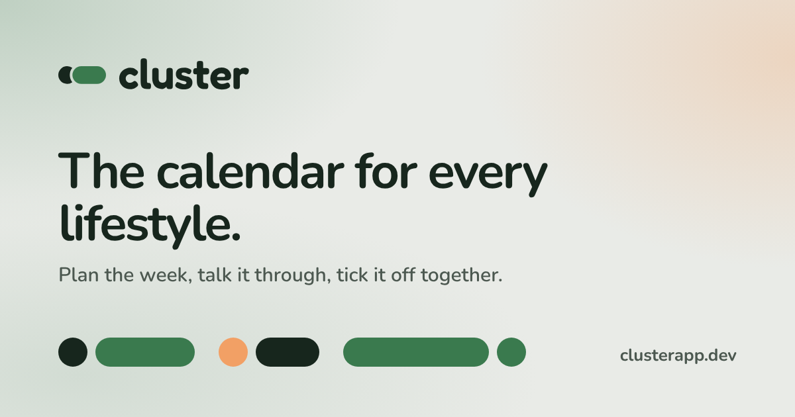
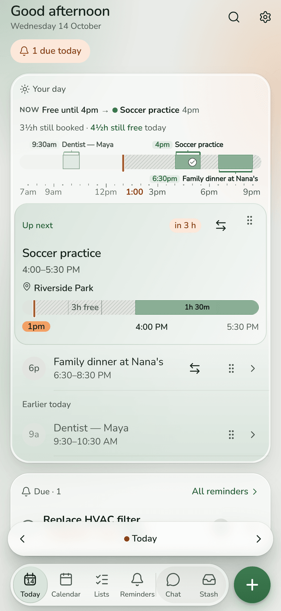
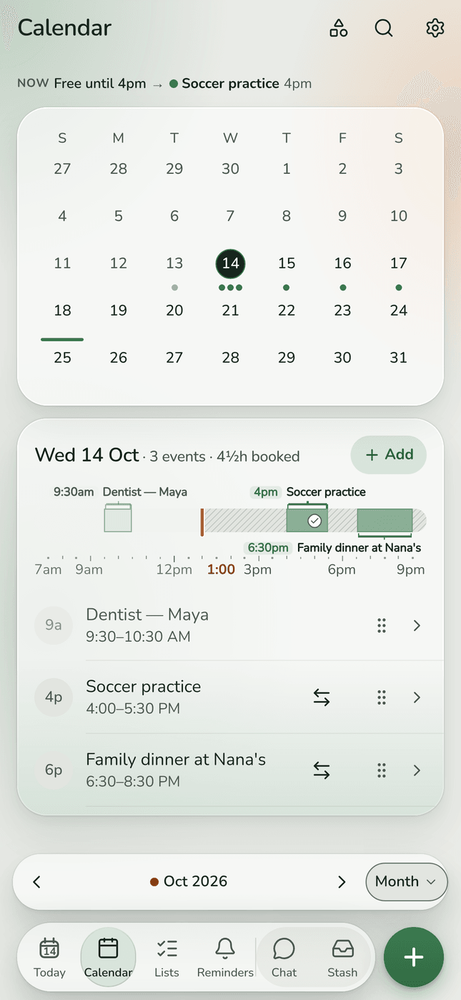
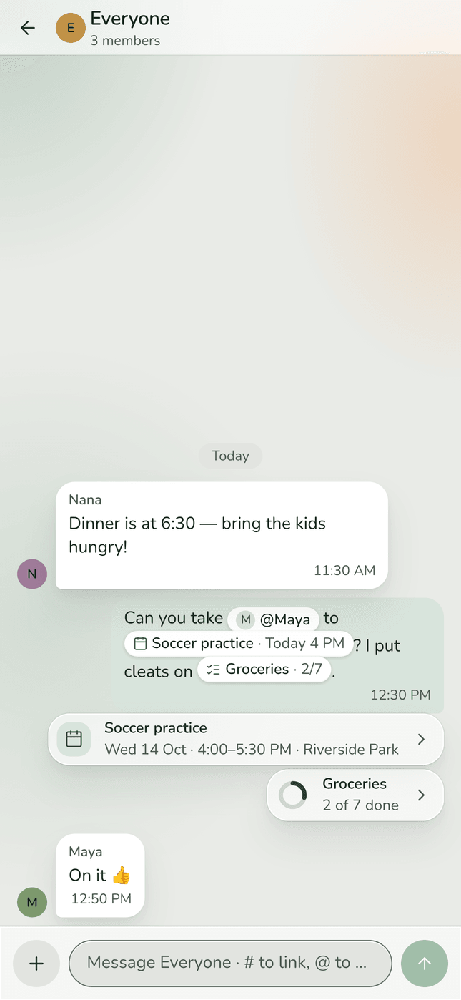
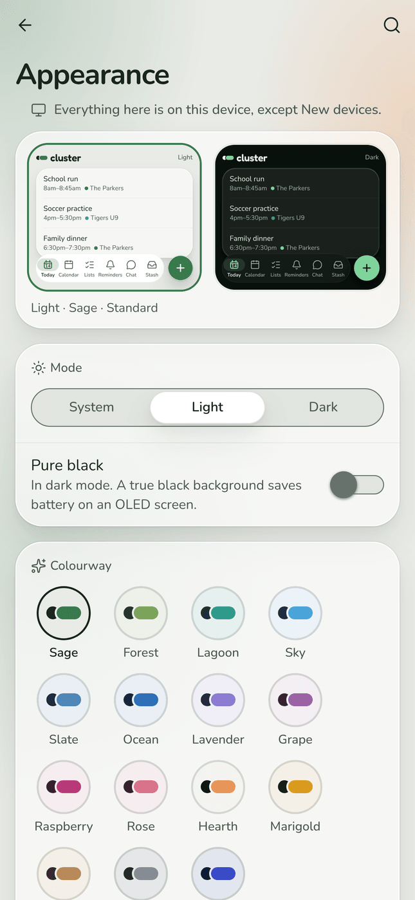

  

# Cluster

**The calendar for every lifestyle.** Shared calendars, lists, reminders and chat for the people
you share a week with. Plan the week, talk it through right beside the plan, tick it off together,
or stash it for later.

- **Web:** <https://clusterapp.dev>, in any browser, on a phone or a computer.
- **Android:** [download `Cluster.apk`](https://github.com/dancki/Cluster/releases/latest/download/Cluster.apk),
  open it on your phone and allow the install. Later builds install over it.
- **iPhone:** on the way.

  
  
  
  

## What this repository is

The built web app, and the public home of the Android download. **No source lives here.**

The source repository is private, and GitHub Pages needs a public repository on a free plan, so
everything under `docs/` is written by the source repository's deploy and served at
<https://clusterapp.dev>. It is replaced wholesale on every deploy: edits made there will be lost.
Merging a change in the source repository deploys it here automatically.

Each Android build from the source repository's `main` is attached to a Release here as
`Cluster.apk` and marked latest, so the download link above always serves the newest one. It is
signed with Expo's standard debug key: fine for installing directly, not for the Play Store.

The pictures above (`media/`) are the source repository's store screenshots
(`pnpm store:screens`, drawn on a sample family) and its share card (`scripts/brand-assets.mjs`).

## Hosting notes

GitHub Pages cannot send custom response headers, so the site is served with only the Content
Security Policy its `index.html` carries as a meta tag, and without clickjacking protection
(`frame-ancestors` works only as a header). That makes this a preview host, not the production
one; the source repository's `docs/ops/production-checklist.md` §5 lists the headers a production
host must send.
